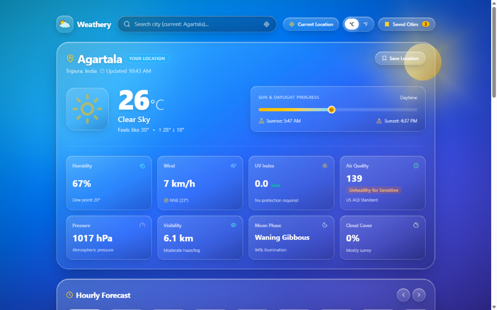
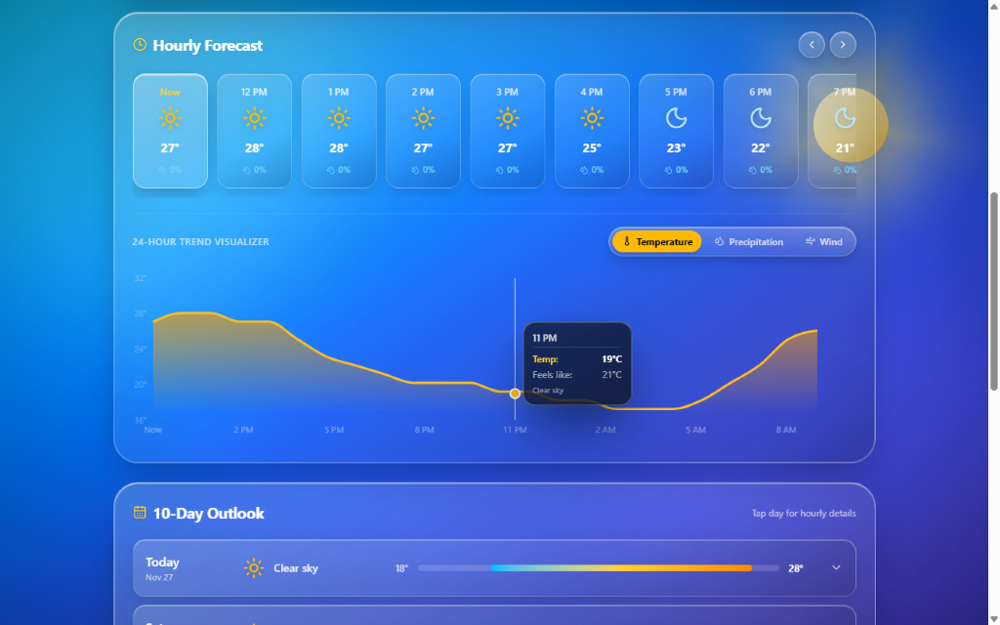
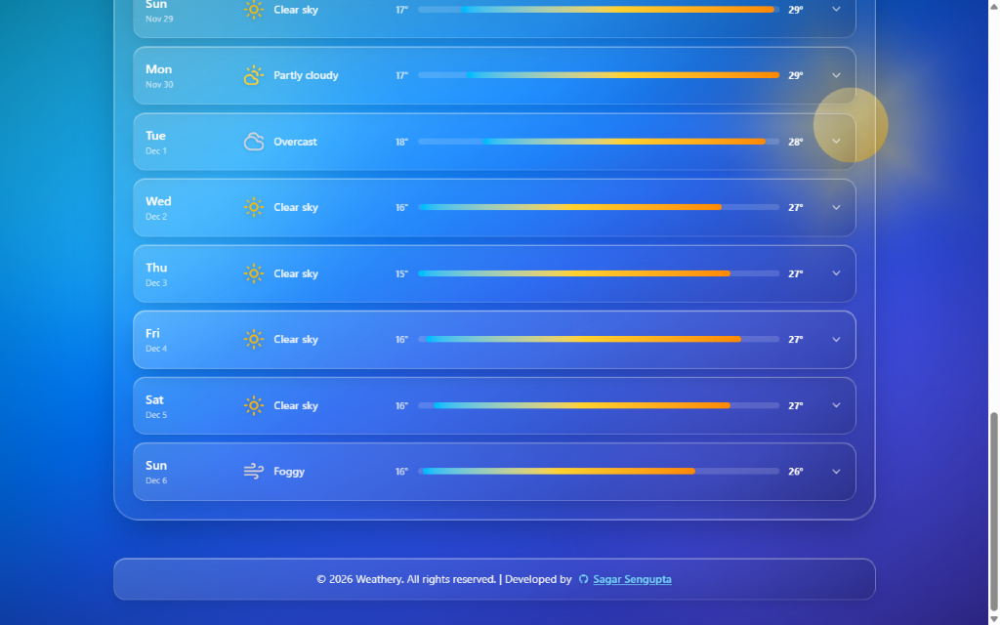
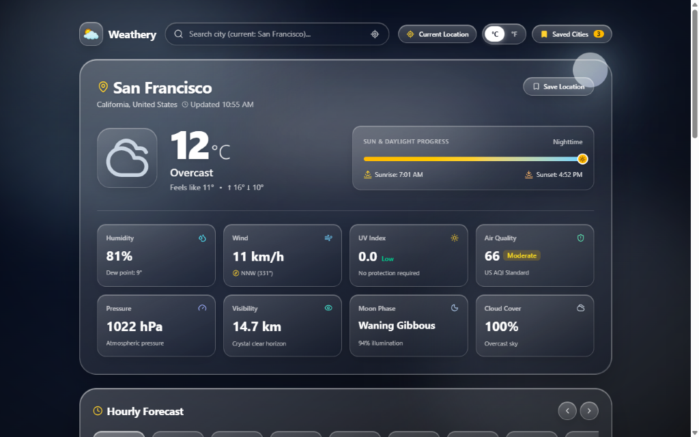

# Weathery Web App

A responsive, modern **Liquid Glass** weather web application built with **React**, **TypeScript**, **Tailwind CSS**, **Recharts**, and free weather APIs (**Open-Meteo** and **BigDataCloud**).

🌐 **Live Demo:** [https://sagarsen2003.github.io/weathery-/](https://sagarsen2003.github.io/weathery-/)

---

## 📸 Screenshots

### Liquid Glass Hero & Current Weather (Desktop)


### Hourly Forecast & Interactive 24-Hour Trend Visualizer


### 10-Day Extended Outlook & Range Bars


### Real-Time Severe Weather Alert & Mobile Responsive View
| Real-Time Severe Alert (Desktop) | Responsive Mobile View (`375px`) |
| :---: | :---: |
|  |  |

### Global Locations & Dynamic Themes
| San Francisco (Overcast Night) | Singapore (Thunderstorm & Live Alert) |
| :---: | :---: |
|  |  |

---

## ✨ Features

1. **Header & Navigation:**
   - **Autocomplete Location Search:** Real-time search with debouncing for cities, states, and countries worldwide.
   - **Recent Searches:** Automatically stores search history in `localStorage` with quick replay and one-click clear.
   - **Current Location Detection:** Instant browser geolocation with reverse geocoding to resolve your city name and local coordinates.
   - **Global °C / °F Unit Toggle:** Seamlessly updates temperatures, wind speeds (`km/h` ↔ `mph`), visibility (`km` ↔ `mi`), and pressure (`hPa` ↔ `inHg`) globally.
   - **Favorites & Pinned Cities Drawer:** Slide-out right Liquid Glass drawer (with `Escape` key support) to pin current locations, manage saved cities, and pick from suggested world capitals.

2. **Current Weather Card:**
   - City name, region, country, and live update timestamp.
   - Weather condition text and crisp condition icons.
   - Large temperature display with **"Feels Like"** temperature and day's high/low range.
   - **Sun & Daylight Progress Bar:** Visual daylight progress bar tracking sunrise to sunset in real time.
   - **8 Secondary Weather Metrics Tiles:**
     - 💧 **Humidity (%)** & Dew point
     - 💨 **Wind Speed & Direction** (compass direction e.g., `NNW`, bearing in degrees)
     - ☀️ **UV Index** (with color-coded severity: Low, Moderate, High, Very High, Extreme)
     - 🛡️ **Air Quality Index (AQI)** (US AQI standard with health advisories)
     - ⏱️ **Atmospheric Pressure** (`hPa` or `inHg`)
     - 👁️ **Visibility** (`km` or `miles` with clarity ratings)
     - 🌕 **Moon Phase** (astronomical phase calculation with illumination percentage)
     - ☁️ **Cloud Cover (%)**

3. **Hourly Forecast (Next 48 Hours):**
   - Horizontal scrollable timeline strip with left/right quick scroll buttons.
   - Time (`Now`, `12 PM`, etc.), condition icon, temperature, and precipitation chance (`%`).

4. **Interactive 24-Hour Trend Visualizer (Charts):**
   - **Temperature:** Smooth spline area chart with radiant amber gradient fill and Liquid Glass tooltip.
   - **Precipitation:** Sky-blue bar chart displaying hourly rain probability (`0%–100%`).
   - **Wind:** Area chart showing wind speed variation over the next 24 hours.

5. **10-Day Extended Outlook:**
   - Daily forecast cards displaying weekday, full date, weather condition icon, condition text, and rain probability.
   - **Temperature Range Bar:** Proportional horizontal gradient bar visualizing the day's minimum and maximum temperatures relative to the week's overall range.
   - **Expandable Accordion:** Click any day to reveal its specific sunrise, sunset, max wind, max UV, and complete 24-hour breakdown.

6. **Real-Time Severe Weather Alert System & Emergency Action Center:**
   - Quietly monitors live weather conditions every 60 seconds and only appears when the selected location experiences actual severe weather (thunderstorms, gale winds, extreme heat, hard freezes, hazardous AQI, or extreme UV).
   - Plays an optional dual-tone alert chime and sends browser notifications when weather transitions to severe.
   - Includes a **"What Action To Take"** Emergency Action Center modal with priority immediate steps, an interactive readiness checklist, Do's & Don'ts matrix, travel/health advice, and emergency contacts.

7. **Liquid Glass UI & Dynamic Weather Backgrounds:**
   - **Liquid Glass Design:** Optical backdrop blur + saturation (`backdrop-filter: blur(...) saturate(...)`), specular edge highlights, and fluid glass pills across every card, drawer, and modal.
   - **Condition-Reactive Dynamic Sky:** Animated sunbeams and glowing sun orb on clear days, twinkling starfields and lunar halo at night, drifting volumetric clouds, animated rain streaks, sheet lightning flashes, snowfall, and rolling fog bands.
   - **Fully Responsive:** Tailored layouts across mobile (`375px+`), tablet (`768px+`), and desktop (`1024px+`) screens with zero horizontal overflow.

---

## 🚀 Getting Started

### Prerequisites

- Node.js (v18 or higher recommended)
- npm or yarn

### Installation

1. Navigate to the project directory:
   ```bash
   cd weather-app
   ```

2. Install dependencies:
   ```bash
   npm install
   ```

3. Start the development server:
   ```bash
   npm run dev
   ```

4. Open your browser and navigate to `http://localhost:5173/`.

---

## 🔑 Weather API Configuration

**Zero Configuration Required!**  
By default, **Weathery** uses **Open-Meteo** (no API key required) and **BigDataCloud** (free client-side reverse geocoding), providing full global coverage out of the box.

If you wish to configure optional commercial API keys, copy `.env.example` to `.env`:
```bash
cp .env.example .env
```
And add your optional keys:
```env
VITE_WEATHER_API_KEY=your_weatherapi_key_here
VITE_OPENWEATHER_API_KEY=your_openweather_key_here
```

---

## 🛠️ Project Structure

```text
weather-app/
├── .github/workflows/deploy.yml   # GitHub Pages automated deployment workflow
├── docs/screenshots/              # Live demo screenshots used in README
├── index.html                     # HTML entry point with metadata & fonts
├── vite.config.ts                 # Vite + Tailwind v4 configuration
├── package.json                   # Dependencies & scripts
├── src/
│   ├── App.tsx                    # Main orchestrator, polling & state manager
│   ├── index.css                  # Liquid Glass design system & atmospheric animations
│   ├── main.tsx                   # React root entry
│   ├── types/
│   │   └── weather.ts             # TypeScript definitions
│   ├── utils/
│   │   ├── audioAlert.ts          # Web Audio API emergency alert chime
│   │   ├── severeWeatherProtocols.ts # Action plans & safety checklists per hazard
│   │   ├── weatherUtils.ts        # Unit conversions, WMO codes, moon phase math
│   │   └── storage.ts             # LocalStorage helpers for saved cities & recents
│   ├── services/
│   │   └── weatherApi.ts          # Open-Meteo & reverse geocode API service
│   └── components/
│       ├── Header.tsx             # Responsive search, autocomplete, geolocation & toggles
│       ├── WeatherBackground.tsx  # Condition-reactive animated sky background
│       ├── WeatherIcon.tsx        # Styled weather condition icons
│       ├── CurrentWeatherCard.tsx # Hero current weather card & 8 metric tiles
│       ├── HourlyForecastTimeline.tsx # Horizontal 48-hr scroll strip
│       ├── WeatherCharts.tsx      # Recharts visualizer (Temp, Rain %, Wind)
│       ├── WeeklyForecast.tsx     # 10-day outlook with range bars & daily expansion
│       ├── SevereAlertBanner.tsx  # Real-time severe weather alert banner
│       ├── EmergencyActionModal.tsx # "What Action To Take" interactive safety center
│       ├── FavoritesDrawer.tsx    # Slide-out saved locations Liquid Glass drawer
│       └── WeatherSkeleton.tsx    # Liquid Glass loading skeleton
```

---

## 📦 Build for Production

To create an optimized production build:
```bash
npm run build
```

To preview the production build locally:
```bash
npm run preview
```
