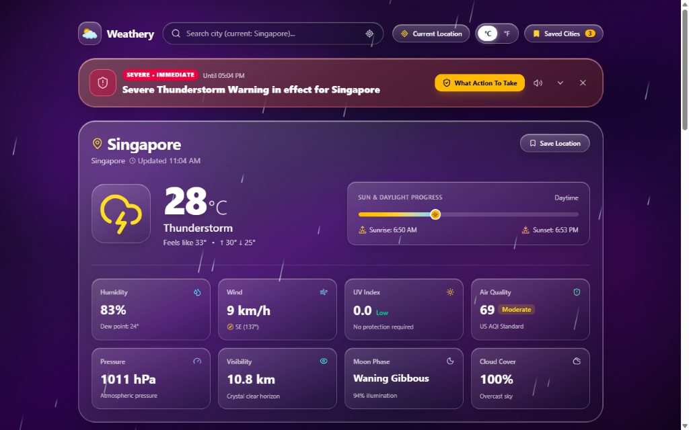
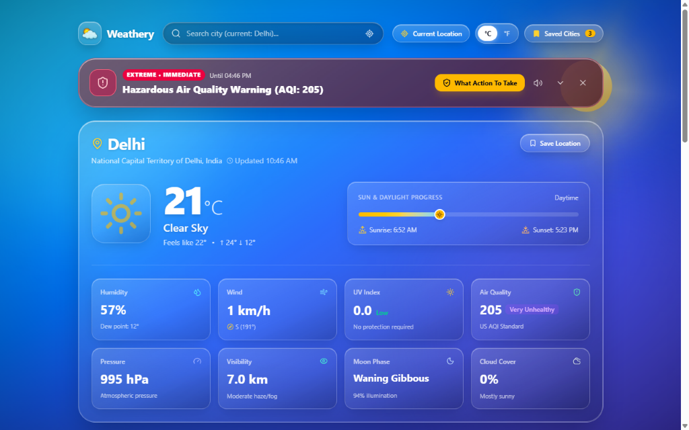
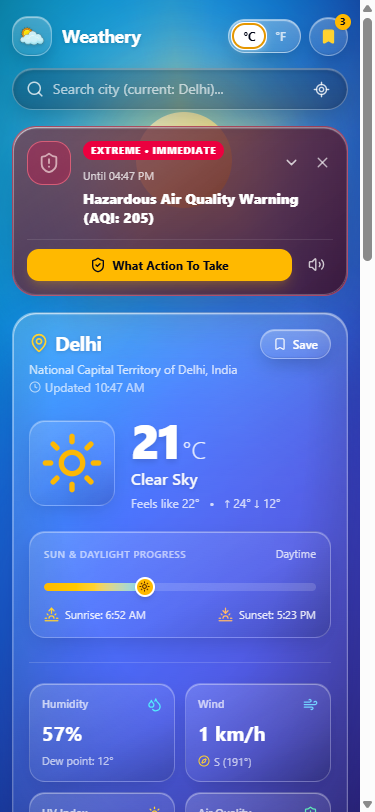

<div align="center">


# Weathery Web App

**Real-Time Global Weather Dashboard, Interactive 24-Hour Trend Visualizer, 10-Day Outlook & Severe Weather Action Center**

Built with a **Liquid Glass UI**, condition-reactive **Dynamic Weather Backgrounds**, real-time **Open-Meteo** & **BigDataCloud** feeds, **Recharts** trend charts, and an interactive **"What Action To Take"** severe weather protocol engine.

### [Live Demo — Launch Weathery](https://sagarsen2003.github.io/weathery-/)

[](https://sagarsen2003.github.io/weathery-/)
[](https://react.dev/)
[](https://www.typescriptlang.org/)
[](https://tailwindcss.com/)
[](https://vite.dev/)
[](https://recharts.org/)
[](https://open-meteo.com/)

Developed by **[Sagar Sengupta](https://github.com/Sagarsen2003)**

</div>

---

## Live Working Demo

> **Live Website:** https://sagarsen2003.github.io/weathery-/  
> Live production captures from the deployed application — showcasing the **Liquid Glass UI**, condition-reactive sky backgrounds (Clear Day, Overcast Night, Thunderstorm & Rain), autocomplete global search, 8 live telemetry tiles, 48-hour forecast strip, interactive Recharts 24-hour trend visualizer, 10-day range bars, **Saved Cities** drawer, and real-time **Severe Weather Alert** action center.

---

## Visual Showcase

### 1. Liquid Glass Hero & Dynamic Daytime Sky (Desktop)


### 2. 48-Hour Forecast Timeline & Interactive 24-Hour Trend Visualizer


### 3. Global Weather Conditions & Dynamic Sky Themes (San Francisco & Singapore)
<table>
  <tr>
    <td width="50%">
      
    </td>
    <td width="50%">
      
    </td>
  </tr>
</table>

### 4. 10-Day Extended Outlook & Range Bars


### 5. Real-Time Severe Weather Alert System & Mobile Responsive Design
<table>
  <tr>
    <td width="58%">
      
    </td>
    <td width="42%">
      
    </td>
  </tr>
</table>

<details>
<summary><strong>View Full-Width Smartphone Responsive Capture (375×812)</strong></summary>
<br />
<div align="center">
  
</div>
</details>

---

## Key Features

- **Liquid Glass UI & Condition-Reactive Sky Engine**
  - Multi-layered frosted glass design (`index.css`) with high-saturation optical blur (`backdrop-filter: blur(28px) saturate(190%)`), diagonal specular rim highlights, fluid glass pills, and high-contrast readability across bright and dark skies.
  - GPU-accelerated dynamic weather background (`WeatherBackground.tsx`) that adapts live to weather codes, day/night state, and ambient temperature — rendering rotating sunbeams and a glowing solar orb on clear days, a lunar halo and twinkling starfield at night, drifting volumetric clouds, animated rain streaks, intermittent sheet lightning flashes, snowfall, and rolling fog bands.
- **Real-Time Global Weather Telemetry & 8 Secondary Metrics**
  - Dual **Open-Meteo** Forecast + Air Quality feeds paired with **BigDataCloud** reverse geocoding for current city, regional state/country, live temperature, **"Feels Like"** reading, daily high/low range, and real-time **Sun & Daylight Progress** tracker.
  - Full 8-tile metrics grid (`CurrentWeatherCard.tsx`): **Humidity & Dew Point**, **Wind Speed & 16-Point Compass Bearing**, **UV Index** severity rating, **US Air Quality Index (AQI)** badge, **Atmospheric Pressure** (`hPa` / `inHg`), **Visibility** (`km` / `mi`), astronomical synodic **Moon Phase** with illumination %, and **Cloud Cover %**.
- **Autocomplete Search, Geolocation, Global Units & Favorites Drawer**
  - Debounced global city search powered by Open-Meteo Geocoding, persistent `localStorage` recent search history with one-click clear, and instant browser geolocation (`Current Location`).
  - Global **`°C` / `°F`** toggle converting temperatures, wind speeds (`km/h` ↔ `mph`), visibility (`km` ↔ `mi`), and pressure (`hPa` ↔ `inHg`) app-wide.
  - Slide-out **Saved Cities** Liquid Glass drawer (`FavoritesDrawer.tsx`) with `Escape` key dismissal, quick city pinning, and preset world capitals.
- **48-Hour Timeline, Recharts Trend Visualizer & 10-Day Outlook**
  - Horizontal scrollable **48-hour forecast strip** (`HourlyForecastTimeline.tsx`) with quick left/right navigation controls and per-hour precipitation probabilities.
  - Interactive **24-Hour Trend Visualizer** (`WeatherCharts.tsx`) powered by Recharts with custom Liquid Glass tooltips and tabs for **Temperature** (amber area spline), **Precipitation** (sky-blue probability bars), and **Wind** (indigo area curve).
  - **10-Day Outlook** (`WeeklyForecast.tsx`) featuring proportional weekly min/max gradient range bars and expandable per-day cards revealing daily sunrise, sunset, max wind, max UV, and hour-by-hour breakdowns.
- **Real-Time Severe Weather Alert System & Emergency Action Center**
  - Quiet 60-second background telemetry polling (`App.tsx`) that stays completely hidden during normal weather and automatically triggers when the selected city experiences severe conditions (thunderstorms, gale winds `> 45 km/h`, excessive heat `≥ 38°C`, hard freeze `≤ -12°C`, hazardous AQI `> 150`, or extreme UV `≥ 9`).
  - Synthesizes a non-intrusive dual-tone Web Audio API chime (`audioAlert.ts`), dispatches browser notifications when permitted, and opens the **"What Action To Take"** Emergency Action Center (`EmergencyActionModal.tsx`) with **Immediate Steps**, an interactive **Safety Checklist** with live readiness progress, a **Do's & Don'ts** matrix, travel/health precautions, and emergency contact numbers.
- **Zero-Config API Setup & Full Device Responsiveness**
  - Works immediately out-of-the-box with zero API keys required, and audited across mobile (`375×812`), tablet (`768×1024`), and desktop (`1280×800+`) viewports with zero horizontal overflow.

---

## Project Architecture

```text
weathery-/
├── .github/workflows/
│   └── deploy.yml                        # GitHub Pages CI/CD build & deploy workflow
├── docs/
│   └── screenshots/                      # Live production captures embedded in README
├── public/
│   └── logo.png                          # Sun-and-cloud app logo & favicon
├── src/
│   ├── components/
│   │   ├── CurrentWeatherCard.tsx        # Hero card, daylight progress bar & 8 metric tiles
│   │   ├── EmergencyActionModal.tsx      # "What Action To Take" interactive safety modal
│   │   ├── FavoritesDrawer.tsx           # Slide-out Saved Cities Liquid Glass drawer
│   │   ├── Header.tsx                    # Responsive search, autocomplete, geolocation & toggles
│   │   ├── HourlyForecastTimeline.tsx    # Scrollable 48-hour forecast strip
│   │   ├── SevereAlertBanner.tsx         # Real-time severe weather alert banner
│   │   ├── WeatherBackground.tsx         # Condition-reactive animated sky background
│   │   ├── WeatherCharts.tsx             # Recharts 24-hour Temperature, Rain % & Wind charts
│   │   ├── WeatherIcon.tsx               # Dynamic condition icons
│   │   ├── WeatherSkeleton.tsx           # Liquid Glass loading skeleton
│   │   └── WeeklyForecast.tsx            # 10-day outlook with range bars & daily breakdown
│   ├── services/
│   │   └── weatherApi.ts                 # Open-Meteo, Air Quality & BigDataCloud client
│   ├── types/
│   │   └── weather.ts                    # TypeScript interfaces across weather & alerts
│   ├── utils/
│   │   ├── audioAlert.ts                 # Web Audio API dual-tone alert synthesizer
│   │   ├── severeWeatherProtocols.ts     # Hazard action plans & safety checklists
│   │   ├── storage.ts                    # LocalStorage helpers for recents, unit & favorites
│   │   └── weatherUtils.ts               # Unit conversions, WMO mapping & moon phase math
│   ├── App.tsx                           # Root state orchestrator, polling & modal control
│   ├── index.css                         # Liquid Glass design system & atmospheric keyframes
│   └── main.tsx                          # React root entry
├── .env.example                          # Optional commercial weather API key template
├── index.html                            # HTML entry point & Google Fonts setup
├── package.json                          # Dependencies & npm scripts
└── vite.config.ts                        # Vite + Tailwind CSS v4 configuration
```

---

## Getting Started

### Prerequisites
- **Node.js** `18+` (recommended `20+`) and `npm`

### Run Locally

```bash
# 1. Clone the repository
git clone https://github.com/Sagarsen2003/weathery-.git
cd weathery-

# 2. Install dependencies
npm install

# 3. Start the development server
npm run dev
```

Open [http://localhost:5173](http://localhost:5173) in your browser.

### Optional API Configuration

**Zero Configuration Required!** By default, Weathery runs on free, keyless **Open-Meteo** and **BigDataCloud** endpoints. If you want to configure optional commercial keys, copy `.env.example` to `.env`:

```bash
cp .env.example .env
```

```env
VITE_WEATHER_API_KEY=your_weatherapi_key_here
VITE_OPENWEATHER_API_KEY=your_openweather_key_here
```

### Production Build & Checks

```bash
npm run lint
npm run build
npm run preview
```

---

## Author

**Sagar Sengupta**
- GitHub: [@Sagarsen2003](https://github.com/Sagarsen2003)

*Built with React, TypeScript & Tailwind CSS. Live surface meteorology, air quality, and geocoding powered by Open-Meteo and BigDataCloud.*
